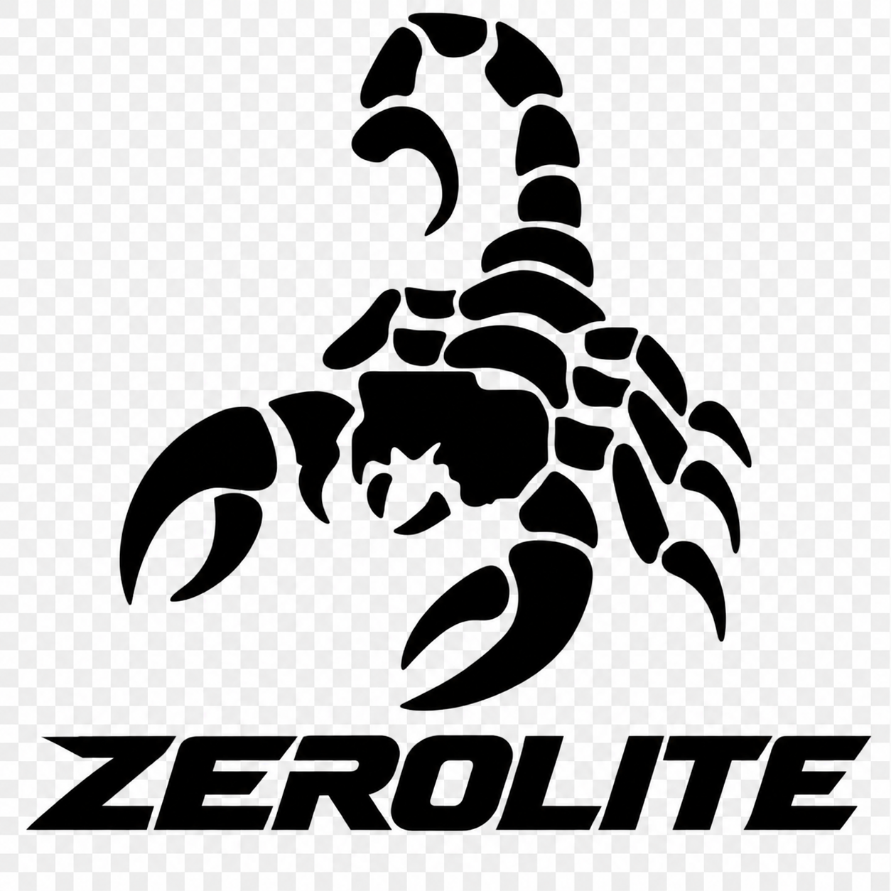

<p align="center">
  
</p>

<h1 align="center">ZeroLite 1.0.0 — Personal AI Assistant</h1>

<p align="center">
  <strong>A ZeroClaw fork. You own the agent, the data, and the machine it runs on.</strong>
</p>

---

ZeroLite is a fork of [ZeroClaw](https://github.com/zeroclaw-labs/zeroclaw). The binary, config file, and commands stay `zeroclaw`. This tree is crate version `1.0.0-lite`; the release tag is `v1.0.0`.

It is still one Rust binary: LLM providers (Anthropic, OpenAI, Ollama, and ~20 others), 30+ channels (Discord, Telegram, Matrix, email, voice, webhooks, CLI), and tools (shell, browser, HTTP, hardware, custom MCP servers). Everything runs on your machine, with your keys, in your workspace.

What this fork adds on top of upstream ZeroClaw 0.8.5. Inherited runtime behavior is under [What the runtime does](#what-the-runtime-does).

## What ZeroLite adds

### Context engine

`zeroclaw-context` sets the send budget and keeps the prefix cacheable. Policy is on the runtime profile:

```toml
[runtime_profiles.coder.context]
max_input_tokens = 100_000      # optional window ceiling
trim_threshold_percent = 80     # default water-line
reserve_tokens = 16_384         # output headroom
keep_recent_turns = 5           # default, clamped 1–10
```

- Past the water-line, keep the newest whole turns, then drop older ones down to one. A turn is never split. If the newest turn still does not fit, the turn fails.
- A trim rewrites stored history and refreshes the meter. Size is a script-aware estimate, then re-anchored on provider `input_tokens`.
- Sends keep the longest byte-stable prefix. Cache hits are `zeroclaw_tokens_cached_input_total` and the composer's cache-hit percent. A child's context budget cannot exceed its parent's.
- Stable prefix: no dates or clocks in the system prompt, channel turn context, or history. `HEARTBEAT.md` loads only for heartbeat. Skill and deferred catalogs are frozen for the session and sorted by name.

[Context management](docs/book/src/agents/context-management.md) · [History management](docs/book/src/agents/history-management.md).

### Web chat

- Context ring, plus `N turns · M steps · … tok · cache hit …%`.
- A turn is ordered steps. Earlier steps collapse (`7 tool calls · 6 messages`); the answer stays open. The transcript stays pinned, and a trim cuts it in place.
- An `https://` markdown image renders in the bubble and in tool steps. Publish the picture to an image host first.
- Denser chrome, message hover actions, and tall images scroll.

### Sessions, pairing, delegates

- `session_search` finds this agent's messages. `sessions_history` can read around a hit (`around_message_id`).
- `gateway.master_pair_code` mints a device token without using up the one-time pairing code. It is a secret, and it does nothing while pairing is off. [Details](docs/book/src/gateway/web-dashboard.md#pairing-recovery-code-gatewaymaster_pair_code).
- Nested background delegates stay visible to their caller.

## Install

Install from the [ZeroLite 1.0.0 release](https://github.com/iintothewind/zeroclaw/releases/tag/v1.0.0). Each binary has the web dashboard embedded. There is no macOS build.

| Platform | Asset |
|---|---|
| Windows x64 | `zerolite-1.0.0-x86_64-pc-windows-msvc.zip` |
| Linux x64 | `zerolite-1.0.0-x86_64-unknown-linux-gnu.tar.gz` |
| Linux arm64 | `zerolite-1.0.0-aarch64-unknown-linux-gnu.tar.gz` |

Linux x64:

```sh
gh release download v1.0.0 -R iintothewind/zeroclaw -p 'zerolite-1.0.0-x86_64-unknown-linux-gnu.tar.gz'
tar -xzf zerolite-1.0.0-x86_64-unknown-linux-gnu.tar.gz
install -m 755 zeroclaw "${CARGO_HOME:-$HOME/.cargo}/bin/zeroclaw"
zeroclaw quickstart
```

Linux arm64: same steps, with `zerolite-1.0.0-aarch64-unknown-linux-gnu.tar.gz`.

Windows (PowerShell):

```powershell
gh release download v1.0.0 -R iintothewind/zeroclaw -p 'zerolite-1.0.0-x86_64-pc-windows-msvc.zip'
Expand-Archive .\zerolite-1.0.0-x86_64-pc-windows-msvc.zip -DestinationPath "$env:USERPROFILE\.cargo\bin"
Rename-Item "$env:USERPROFILE\.cargo\bin\zerolite-1.0.0-x86_64-pc-windows-msvc.exe" zeroclaw.exe
zeroclaw quickstart
```

## Quick start

```bash
zeroclaw quickstart               # one-shot setup: pick a provider, write a working config
zeroclaw agent -a <alias>         # interactive chat using the [agents.<alias>] entry
zeroclaw service install          # register as systemd/launchctl/Windows Service
zeroclaw service start            # run it always-on in the background
```

Full walkthrough: [Quick start](docs/book/src/getting-started/quickstart.md) — or skip the safety gates with [YOLO mode](docs/book/src/getting-started/yolo.md) for dev boxes.

## What the runtime does

- **Multi-channel** — one agent answering you across [every channel you configure](docs/book/src/channels/overview.md). Inbound messages from Discord, Telegram, Matrix, email, webhooks, CLI — all delivered to the same agent loop.
- **Provider-agnostic** — [model providers](docs/book/src/providers/overview.md) are pluggable. Configure Anthropic, OpenAI, local Ollama, or any OpenAI-compatible endpoint. [Fallback chains and routing](docs/book/src/providers/routing.md) keep the agent running when a provider flakes.
- **Security-first, with escape hatches** — default autonomy is `supervised`: medium-risk ops require approval, high-risk blocked. Workspace boundaries, command policy, OS-level sandboxes (Landlock / Bubblewrap / Seatbelt / Docker), and cryptographic [tool receipts](docs/book/src/security/tool-receipts.md) on every action. [YOLO mode](docs/book/src/getting-started/yolo.md) exists for trusted dev environments.
- **Hardware-capable** — GPIO / I2C / SPI / USB on Raspberry Pi, STM32, Arduino, and ESP32 via the `Peripheral` trait. See [Hardware](docs/book/src/hardware/index.md).
- **Gateway + dashboard** — HTTP / WebSocket gateway for clients, with a web dashboard for chat, memory browsing, config editing, cron management, and tool inspection.
- **SOP engine** — event-triggered [Standard Operating Procedures](docs/book/src/sop/index.md) (MQTT / webhook / cron / peripheral) with approval gates and resumable runs.
- **ACP** — IDE / editor integration via [Agent Client Protocol](docs/book/src/channels/acp.md) (JSON-RPC 2.0 over stdio).

## Configuration

One TOML file at `~/.zeroclaw/config.toml`. Pointers:

- [Provider configuration](docs/book/src/providers/configuration.md) — the universal `[providers.models.<type>.<alias>]` schema
- [Channels overview](docs/book/src/channels/overview.md) — per-channel `[channels.<type>.<alias>]` blocks
- [Security overview](docs/book/src/security/overview.md) — autonomy, sandboxing, tool receipts
- [Full config reference](https://docs.zeroclaw.com/master/en/reference/config.html) — generated from the live schema; every key documented

A V3 config has at minimum four section headers (`<type>.<alias>` shaped) — a provider entry, an agent that references it, and a risk profile the agent gates against. See [Provider Configuration → Minimal working example](docs/book/src/providers/configuration.md#minimal-working-example) for the canonical four-section form with inline type/alias commentary.

For standard OpenAI Codex subscription auth, Quickstart can write the provider
entry for you:

```bash
zeroclaw auth login --model-provider openai-codex --import ~/.codex/auth.json  # if already signed in with Codex CLI
zeroclaw quickstart --model-provider openai-codex --model gpt-5.4
```

The provider entry uses the canonical OpenAI shape; the alias below is an
example:

```toml
[providers.models.openai.coding]   # type = openai; alias = coding (you choose)
model = "gpt-5.4"
wire_api = "responses"
requires_openai_auth = true
```

…and point your agent at it with `model_provider = "openai.<alias>"`.

Notes:

- Normal OpenAI Codex subscription auth uses stored auth profiles, not an `api_key` on the provider entry.
- Claude Max setup-token auth stays on the canonical Anthropic slot: run `claude setup-token`, choose `setup_token` in Quickstart, and paste the generated token into the API key/token prompt.
- Only set `api_key` / `uri` on `[providers.models.openai.<alias>]` when intentionally targeting a custom OpenAI-compatible gateway or endpoint.
- If you see `provider streaming failed, falling back to non-streaming chat`, ZeroClaw retries the same request in non-streaming mode. Check `zeroclaw auth status` before changing provider config.

## Architecture

```
┌──────────────────────────────────────────────────────────────┐
│            channels       gateway        ACP                 │
│          (30+ adapters)   (REST/WS)    (JSON-RPC)            │
│                        ↓                                     │
│                   ZeroClaw runtime                           │
│         ┌──────────┬──────────┬──────────┐                   │
│         │  agent   │ security │   SOP    │                   │
│         │   loop   │  policy  │  engine  │                   │
│         └──────────┴──────────┴──────────┘                   │
│              ↓          ↓           ↓                        │
│          providers    tools      memory                      │
│         (Anthropic,  (shell,    (SQLite,                     │
│          OpenAI,     browser,    embeddings)                 │
│          Ollama,     HTTP,                                   │
│          ~20 more)   hardware)                               │
└──────────────────────────────────────────────────────────────┘
```

Full detail with Mermaid diagrams: [Architecture overview](docs/book/src/architecture/overview.md) · [Request lifecycle](docs/book/src/architecture/request-lifecycle.md) · [Crates](docs/book/src/architecture/crates.md).

## License

Dual-licensed: [MIT](LICENSE-MIT) OR [Apache 2.0](LICENSE-APACHE). You may choose either.
